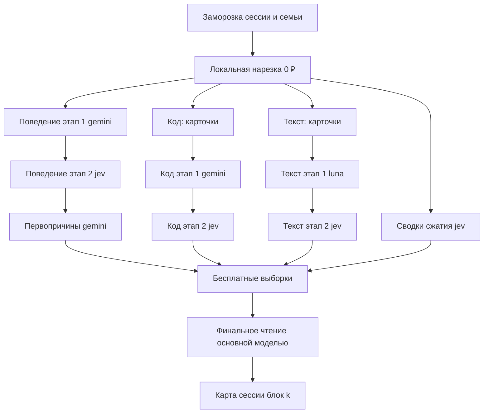

# Экспериментальный режим decide-mcp для навыка pi-retrospective

**Статус:** черновик проектирования. Ничего не реализовано, навыки не правились, платных вызовов не было (0 ₽). Маршрут в `docs/README.md` не добавлен: это черновик на один файл, решение о маршруте — за владельцем.
**Что изучено:** `~/.agents/skills/pi-retrospective` (SKILL.md, modes/single-session.md, references/evidence-and-goals.md, subagent-lanes.md, pi-session-stores.md, human-summary.md, retrospective-files.md, mermaid-diagrams.md, maintenance.md, templates/session-card.md, templates/day-file.md, checklists/retro-done.md, examples/session-card-example.md) и `~/.agents/skills/pi-session-finder` (SKILL.md, scripts/README.md, references/pi-session-store.md). Со стороны decide-mcp сверены `docs/architecture/contracts.md`, `docs/architecture/providers-and-models.md`, `docs/guides/ru/rubrics-and-funnels.md`, `docs/plans/mvp-scope.md`, `src/core/sources.ts`, `src/core/prefilter.ts`, `src/core/query.ts`, `src/core/registry.ts`, `src/servers/mcp.ts`.
**Границы:** заметка не цитирует личные факты, приватную переписку и реальные сессии. Все примеры рубрик — синтетические. Ни один файл навыка не создан и не изменён.

---

## 1. Как навык устроен сейчас

### 1.1 Файлы и их роли

| Файл | Роль | Когда читается |
|---|---|---|
| `SKILL.md` | вход, триггерный гейт, маршрутизация двух работ, глобальные правила | при загрузке навыка |
| `README.md` | человеческое описание | перед передачей навыка человеку |
| `modes/single-session.md` | 7 шагов вскрытия одной сессии | когда просят разобрать одну сессию |
| `references/evidence-and-goals.md` | иерархия доказательств, извлечение требований, словарь вердиктов | перед шагами 3 и 5 |
| `references/subagent-lanes.md` | нарезка на дорожки, контракт брифа, лимиты | при большой семье сессий |
| `references/pi-session-stores.md` | мост к канону хранилищ сессий | перед любым чтением `.jsonl` |
| `references/retrospective-files.md` | имена файлов, интервалы, README-индекс, реестр | перед шагом 6 |
| `references/human-summary.md` | язык и стиль отчёта в чате | перед шагом 7 |
| `references/mermaid-diagrams.md` | правила диаграмм и необязательный валидатор | перед рисованием |
| `references/maintenance.md` | слои, лимиты, запреты, правило форка | перед любой правкой навыка |
| `templates/session-card.md` | скелет карты «кто я — где я» | шаг 5 |
| `templates/day-file.md` | скелет дневного файла | шаг 6 |
| `templates/readme-index.md`, `templates/registry-entry.md` | индекс и строка реестра | шаг 6 |
| `checklists/retro-done.md` | финальный чек-лист | перед выдачей |
| `examples/session-card-example.md` | учебная карта на вымышленных данных | перед заполнением реальной |
| `journal/defect-log.md`, `journal/mermaid-defects.md` | журналы дефектов | во время и после прогона |
| `evals/evals.md` | тест-кейсы триггеров и качества | при улучшении навыка |

### 1.2 Два дела и шаги одиночного вскрытия

Навык делает две работы одним методом: ретроспективу за период и вскрытие одной сессии с её семьёй. Вскрытие идёт семью шагами:

1. **Границы** — одна сессия, её проект, семья (подагенты, форки, артефакты, `run-history.jsonl`), срез и отсечка.
2. **Список требований** — каждый запрос владельца отдельной строкой, с источником (время или id сообщения).
3. **Таймлайн** — «спрошено / сделано / первичное доказательство / осталось»; вердикт только по файлам, диффам, проверкам и коммитам.
4. **Диагностика качества** — три формы сбоя: дрейф, ложное «готово», обрыв или молчаливый отказ (две разновидности одной формы).
5. **Карта сессии** — блоки (a)–(j), пустое поле отвечается явно, пропущенный блок — ошибка.
6. **Автообучение** — по готовому разбору, не по сырому транскрипту, со стоп-правилом памяти.
7. **Отчёт и передача** — файлы, строка реестра, чек-лист, текст в чат от саба, список «ждёт твоего слова» последним.

### 1.3 Узкие места, ради которых нужен decide

| # | Где | В чём узкое место | Что может дать decide |
|---|---|---|---|
| 1 | Шаг 4 | Всего три формы сбоя: дрейф, ложное «готово», обрыв. Нет зацикливания, нет класса «ошибка инструмента обработана плохо», нет потери нити после сжатия, нет качества брифа субагента | отдельная таксономия на каждый класс, одинаковая от прогона к прогону |
| 2 | Шаг 4 | Диагностика качественная и зависит от того, сколько текста модель успела прочитать | числовая воронка: широкий скрин → короткие карточки → полный текст только у финалистов |
| 3 | Шаг 3 | Чтение семьи ограничено контекстом; дорожки помогают, но каждая всё равно читает сырой текст | скелет с детерминированными тегами и `from_run` снижают объём чтения на порядок |
| 4 | Шаг 5 | Качество артефактов оценивается слитно: код и текст имеют разные провалы, а места под них в карте нет | две отдельные ветки рубрик и отдельные прогоны |
| 5 | Шаг 5 | Ложное «готово» фиксируется по утверждению, а не по артефакту: утверждение может быть технически верным при плохом результате | пара «утверждение ↔ доказательство» и отдельная оценка доставки |
| 6 | Везде | Сжатие контекста упомянуто только как ловушка чтения, а не как диагностируемое событие | рубрика непрерывности по сводке сжатия и следующим ходам |
| 7 | Шаг 2 | Брифы субагентов предписаны `subagent-lanes.md`, но навык не проверяет, соответствовали ли его собственные брифы этому контракту | рубрика, которая оценивает бриф по тем же пяти пунктам |
| 8 | Везде | Нет дешёвого первого прохода, который решает, где тратить дорогое чтение | воронка за единицы рублей на сессию до финального чтения |

---

## 2. Куда втыкается экспериментальный файл

### 2.1 Имя и статус

Целевой файл: `~/.agents/skills/pi-retrospective/modes/experimental-decide.md`.

Шапка файла (предлагаемая):

```yaml
---
experimental: true
status: draft
version: "0.1"
skill: pi-retrospective 1.4.0
requires: decide-mcp >= 0.1.0, MCP-инструменты decide_run / decide_query / decide_models
cost: "платные decision-вызовы; сначала dry_run, стоимость из usage.cost_rub"
---
```

Файл — **лист**, а не новая работа навыка. Он не добавляет триггеров, не меняет маршрутизацию и не входит в постоянную карту файлов `SKILL.md`.

### 2.2 Как включается вручную

Только явным указанием владельца, тремя равнозначными способами:

- фразой «включи экспериментальный режим decide» / «прогони вскрытие через decide»;
- точным путём к файлу;
- словами «с воронкой decide» в запросе на вскрытие.

Правило внутри файла: **если файл не был прочитан явно в этом прогоне, он не действует.** Это защита от того, чтобы обычное «вскрой сессию» незаметно превращалось в платный эксперимент.

### 2.3 Почему не дописывать в SKILL.md

1. `references/maintenance.md` держит тело `SKILL.md` под 500 строками и запрещает складывать детали входа туда.
2. Там же лимит `modes ≤ 3 (сейчас 1)`: экспериментальный режим — второй файл, лимит не нарушен.
3. Триггерный гейт остаётся один. Второй набор условий заставляет оркестратора спорить с собой в thinking: «это ретроспектива или эксперимент?»
4. Эксперимент будет меняться часто; `SKILL.md` — стабильный контракт, его нельзя трясти каждую неделю.
5. Удаляемость: убрать один файл — навык ровно такой, как до эксперимента. Ни одной висячей ссылки.
6. Заметка и черновики рубрик живут в decide-core; до решения владельца в навыке не появляется даже файл.

### 2.4 Что режим заменяет и что не трогает

- **Берёт** шаги 1–3 из `modes/single-session.md` (границы, требования, таймлайн).
- **Заменяет** шаг 4 (диагностика качества) конвейером D0–D7: D0 замораживает границы шага 1, D1–D5 дают диагностику, D6–D7 — выборки и финальный разбор.
- **Дополняет** шаг 5 новым блоком карты `(k) Decision screening`; блоки (a)–(j) остаются как есть.
- **Не трогает** шаг 6 (автообучение) и шаг 7 (отчёт и передача): они выполняются по основному навыку.
- **Пишет** только то, что навык и так пишет: карта, строка дневного файла, строка реестра. Новых верхнеуровневых отчётов не создаёт.
- **Не меняет** файлы сессий, не правит навык, не трогает память в обход `pi-memory-ops`.

### 2.5 Каркас файла режима

```markdown
# Mode — experimental decide screening

## When this file applies
Только по явному указанию владельца. Не триггер. Не в карте файлов SKILL.md.

## What it borrows and what it replaces
Шаги 1–3 и 6–7 — modes/single-session.md. Шаг 4 заменяется на D1–D5; D0 замораживает границы шага 1, D6–D7 — выборки и финальный разбор.
Карта получает блок (k). Блоки (a)–(j) не переписываются.

## D0. Границы и заморозка
## D1. Локальная нарезка (0 ₽)
## D2. Широкая поведенческая воронка
## D3. Глубокая диагностика
## D4. Первопричины и адрес правки (только при подтверждённых сбоях)
## D5. Артефакты: одна ветка — код или писатель
## D6. Бесплатные выборки decide_query
## D7. Короткий финальный разбор основной моделью

## Rubrics inline (single canon)
## Fallback and stop rules
## What goes into the card (block k)
## What never goes into the card
```

### 2.6 Что режим обязан соблюдать

- Не пересказывать `pi-session-store.md` и правила памяти — только ссылки на них (запрет `maintenance.md`).
- Не запускать платный вызов без `dry_run` в том же прогоне.
- При ошибке decide-mcp (нет сервера, `invalid_rubric`, `path_outside_root`) — вернуться к шагу 4 основного режима и **сказать об этом явно**, а не тихо подменять анализ догадкой.
- Не смешивать в одном `decide_run` элементы разной природы: поведение, брифы, сжатия, код и текст — разные прогоны с разными рубриками.
- Не выдавать оценки decide за вердикт: вердикт по-прежнему закрывается только первичным доказательством.

---

## 3. Пошаговый конвейер

### 3.0 Три принципа

1. **Дешёвое считаем локально, дорогое спрашиваем у модели.** Повторы, длины, времена, наличие файла, число коммитов, совпадение строк — это счёт, а не суждение. Модель спрашивают только там, где нужно читать смысл.
2. **Модель видит сжатый дайджест, основная модель — оригинал.** В платный вызов уходит контролируемый по размеру дайджест; полный текст финалистов читает основная модель из замороженной копии.
3. **Оценка — улика-наводка, вердикт — по первоисточнику.** Строка карты закрывается файлом, диффом, проверкой или коммитом; счёт decide её не закрывает.

### 3.0.1 Минимальный v0.1 — три платных прогона

Чтобы эксперимент не превратился в восемь дорогих проходов, v0.1 фиксирует ровно три:

1. **Поведение, широкий скрин** — `turn_phase` + `problem_score` на каждом ходе, `gemini`.
2. **Глубокая диагностика/брифы** — один прогон по кандидатам: поведенческие оси, а если сессия про делегирование — карточки брифов; не оба набора сразу.
3. **Ровно одна ветка артефактов** — код **или** писатель, по типу сессии; вторая ветка не запускается.

Всё остальное — только при наличии события:

- первопричины — если есть подтверждённые сбои с `impact_severity >= 2`;
- непрерывность сжатия — если в сессии есть записи `compaction`;
- «утверждение ↔ доказательство» — если в карте есть спорные claims;
- вторая ветка артефактов — если сессия реально произвела и код, и текст (редкий случай).

D0/D1 и D6/D7 бесплатны и в счёт трёх прогонов не входят.

### 3.1 D0. Границы и заморозка (0 ₽)

- Взять ровно одну сессию и её семью по шагу 1 основного режима; список требований — шаг 2.
- Заморозить копию файла сессии и списка семьи в рабочий каталог аудита. Живую сессию не читать: файл растёт, отсечка плывёт.
- Зафиксировать отсечку и записать её в `manifest.json`.
- Проверить 7-дневное окно артефактов подагентов. Истекло — пометить «доказательства утрачены» и **не** оценивать качество артефактов по словам агентов.

### 3.2 D1. Локальная нарезка (0 ₽)

Один локальный проход, без сети. Вход: замороженная сессия, семья, `asks.json` (список требований из шага 2 с дословными цитатами и указателями). Выход: `audit/turns.jsonl`, `audit/compactions.jsonl`, `audit/code_items.jsonl`, `audit/text_items.jsonl`, `audit/manifest.json`.

**Почему нужна отдельная нарезка.** `src/core/sources.ts` для `jsonl` берёт плоские поля записи (`step_id`/`id`, `reasoning`/`thinking`, `tool_name`, `arguments`, `status`, `error`, `result`). Реальный файл Pi — это `message` с массивом блоков `text` / `thinking` / `toolCall` и отдельные записи `toolResult`; в `reasoning` такого файла ничего не попадёт, а `content` склеится в JSON блоков. Кормить сырой сессией Pi `jsonl`-источник нельзя: скелет получится мусорным. `session_dump.py` тоже не подходит как источник: он отдаёт Markdown, а decide нужен плоский JSONL.

**Схема строки `turns.jsonl`:**

```json
{
  "step_id": "t0042",
  "role": "assistant",
  "request": "req#3: дословная цитата требования, до 200 символов, с указателем",
  "tool_name": "bash",
  "arguments": "bash: команда, до 300 символов",
  "status": "ok; after_compaction=1",
  "error": "текст ошибки, если была",
  "reasoning": "дайджест, см. ниже",
  "response": "текст ответа агента, до 400 символов",
  "result": "результат инструмента, до 300 символов",
  "window_before": "t0040: одна строка; t0041: одна строка",
  "window_after": "t0043: одна строка; t0044: одна строка",
  "reasoning_digest": true
}
```

- `step_id` — стабильный id записи сессии (не порядковый номер): по нему потом находится оригинал.
- `request` — `req#N` плюс дословная цитата или точный фрагмент требования с указателем. Скелет обрезает его до 200 символов; если цитата длиннее, локально кладётся начало и `sourceRef` на полный текст.
- `status` — статус инструмента плюс локальный маркер `after_compaction=<N>`, если ход идёт после сводки сжатия. Поле `status` в скелете не обрезается — удобный носитель маркера.
- `reasoning` — **дайджест**, а не полный текст: первые ~1200 символов, до трёх окон ±300 символов вокруг маркеров разворота (`Wait`, `Actually`, `Подождите`, `Но нет`, `стоп`), последние ~1200 символов, общий потолок ~4000 символов. Это закрывает слепое пятно скелета, который показывает только первые и последние 200 символов.
- `window_before` / `window_after` — по два соседних хода одной строкой (≤300 символов каждый). В скелет не попадают (он их не знает), в `raw` попадают: это и есть эпизод для глубокой карточки.
- Метрики ступора считаются локально: длина серии одинаковых вызовов (`repeat_tool`), суммарные токены reasoning на серию и число ходов без изменения файлов. В карточку идёт готовое число; модель его не пересчитывает.
- Полный `reasoning` в файл аудита не пишется; он остаётся в замороженной копии сессии и читается основной моделью только у финалистов.

**Сводки сжатия.** Каждая запись `compaction` даёт отдельную строку в `compactions.jsonl`: `step_id`, `summary` (текст сводки), `before` (два хода до), `after` (три хода после), `summary_chars`. Это вход отдельной рубрики непрерывности.

**Артефакты.** Готовятся обе нарезки, но в v0.1 запускается только одна ветка:

- `code_items.jsonl` — одна карточка на файл или логический фрагмент диффа: `step_id`, `card` = `ТЗ (req#N): ...` + `ФАЙЛ: ...` + `ДИФФ:` + `ПРОВЕРКА: строка о том, что реально запускалось или что проверок не было`.
- `text_items.jsonl` — одна карточка на раздел или весь документ (если он влезает в `luna`): `step_id`, `card` = `ЗАДАНИЕ: ...` + `ИСТОЧНИКИ: ...` + `ТЕКСТ: ...`.

**Секреты до API, строгая маска — только перед Git.** Перед платным вызовом из карточек вырезаются только живые секреты: ключи, токены, `Bearer`, cookie, пароли. Дословные цитаты владельца **не вырезаются и не пересказываются**: по ним сверяется цель, а пересказ теряет точность. Пути, имена людей и организаций, домашние каталоги и приватные фрагменты маскируются отдельным проходом **только перед записью артефакта в Git** (карта, дневной файл, заметка); в API они могут уходить, как и в обычной сессии. `manifest.json` хранит счётчики живых секретов и масок Git-прохода, без значений. Приёмка: до API — ноль живых секретов; перед Git — ноль путей, имён и цитат.

**Проверка нарезки.** `turns.jsonl` читается локальным пробным прогоном `decide_run` с `dry_run: true`: число элементов, токены, батчи. Если один ход не влезает в `per_question` лимит модели — резать дайджест, а не надеяться на `skipped_too_large`.

### 3.3 D2. Широкая поведенческая воронка

Все рубрики — inline-объекты из файла режима; в примерах поле `rubric` показано сокращённо, полный текст — в §4.x.

```json
{
  "model": "gemini",
  "source": {
    "type": "jsonl",
    "path": "audit/turns.jsonl",
    "id_field": "step_id",
    "projection": "skeleton",
    "prefilter_tags": true
  },
  "scope": "per_item",
  "rubric": { "name": "session_audit_behavior_stage1_v1", "guide": "...", "questions": { "turn_phase": { "type": "choice" }, "problem_score": { "type": "score" } } },
  "dry_run": true,
  "return_top": 50,
  "sort_by": { "question_id": "problem_score", "field": "score", "order": "desc" }
}
```

- **Модель:** `gemini` — 262 144 токена, 256 вопросов на запрос, 11.72 ₽/1M. Два вопроса на элемент (`turn_phase` + `problem_score`) → до 128 ходов в батче, 1 000 ходов — восемь батчей. Это дешёвый `Speculative fan-out`: фаза даёт расклад бюджета, score — проблемность, лишние ветки не стоят отдельных вызовов.
- **Почему скелет:** в запрос идут роль, инструмент, аргументы, статус, первые/последние фразы reasoning и теги `reasoning_toks`, `repeat_tool`, `repeat_reasoning`, `tool_error`, `reversals`, `invalid_json`. Этого достаточно, чтобы отделить рутину от подозрительных ходов.
- **Дешёвая альтернатива `ms`:** 32 768 токенов, ~150 вопросов, 4.92 ₽/1M. Годится только для очень коротких строк (≤400 символов) и очень длинных сессий; на замерах 100 шагов × 2 вопроса дала 1.69 ₽/1000, но из-за узкого окна делает больше батчей, чем кажется по цене. Основной вариант — `gemini`; `ms` — черновой фильтр для сессии на 600+ ходов, когда важен каждый рубль.
- **Санитарная проверка распределения:** после прогона посмотреть `summary.problem_score.buckets` и `summary.turn_phase`. Раскладка фаз сразу показывает бюджет сессии: сколько ходов ушло на исследование, реализацию, проверку, ремонт и делегирование. Если в ступени 2–4 ушло больше половины ходов, рубрика или нарезка неверны — остановиться и перечитать, а не гнать дальше.
- **Маршрутизация:** грубый срез по `problem_score` — только чтобы не гнать всё; окончательная маршрутизация — по гейту §4.9 (серая зона, `confidence`, `margin`), а не по одному числу.

### 3.4 D3. Глубокая диагностика поведения

```json
{
  "model": "jev",
  "source": {
    "type": "from_run",
    "run_id": "<stage1_run_id>",
    "where": {
      "logic": "and",
      "conditions": [
        { "question_id": "problem_score", "field": "score", "op": ">=", "value": 1.5 }
      ]
    },
    "context_window": 0,
    "projection": "raw",
    "limit": 60
  },
  "scope": "per_item",
  "rubric": { "name": "session_audit_behavior_stage2_v1", "guide": "...", "questions": { "reasoning_loop": { "type": "bool" }, "impact_severity": { "type": "score" }, "failure_origin": { "type": "choice" } } },
  "return_top": 50
}
```

- **Модель:** `jev` — 64 000 на запрос, **32 000 на один вопрос**, 256 вопросов, жёстко 2–10 ступеней score, 17.09 ₽/1M. Это точное судейство по **компактным** карточкам; крупные эпизоды в `jev` не гнать.
- **`where` — только грубый срез кандидатов, не финальный гейт:** серые случаи, расколы и низкий `confidence` добираются по §4.9; `1.5` здесь — не порог вердикта.
- **Почему `raw`, а не `full`:** `from_run` перечитывает строку исходного файла и оборачивает её заголовком эпизода `--- id (seq N) [target] ---`; `raw` отдаёт компактный JSON с дайджестом и `window_before/after`, `full` — тот же JSON с отступами, дороже по токенам. `context_window: 0`, потому что эпизод уже внутри строки.
- **Потолок батча — с двойным запасом, а не впритык:** у `jev` state + один вопрос ≤ 32K. Держать state ≤ 12–15K: при карточке ~1.5K токенов это 8–10 карточек на батч, 12 вопросов × 10 = 120 ≤ 256; шестьдесят карточек — 6–8 батчей. В слепом тесте `jev` на тесном запасе 27K потерял 11 из 36 крупных шагов и удвоил цену батчей — этот запас не брать.
- **Крупные эпизоды — в `gemini`:** если карточка больше ~12K токенов (полный reasoning, большой дифф), она уходит в `gemini` (262K): 12 вопросов × 20 карточек = 240 ≤ 256, state ~60K — один батч. `luna` — только если эпизод больше 200K. Делить рубрику на две по 5–6 вопросов — последний вариант: state повторяется в каждом батче.
- **Что именно спрашиваем:** 12 атомарных вопросов из §4.2. Каждый — отдельная ось; ответы внутри одного запроса не видят друг друга, поэтому «главная причина» отдельным вопросом `failure_origin`, а не выводом из других.

### 3.5 D4. Первопричины и адрес правки (опционально)

Шаг включается только при наличии подтверждённых сбоев с `impact_severity >= 2`; без них он не запускается. Фрагмент вызова показан сокращённо; полный объект рубрики — в §4.8.

```json
{
  "model": "gemini",
  "source": {
    "type": "from_run",
    "run_id": "<stage2_run_id>",
    "where": {
      "logic": "and",
      "conditions": [
        { "question_id": "impact_severity", "field": "score", "op": ">=", "value": 2 }
      ]
    },
    "projection": "raw",
    "limit": 40
  },
  "scope": "per_item",
  "rubric": { "name": "session_audit_root_cause_v1", "guide": "<общий guide + оглавление инструкций сессии>", "questions": { "...": "..." } },
  "return_top": 40
}
```

- **Модель:** `gemini` или `luna`; `jev` здесь плох, потому что карточки длинные и упираются в 32K на вопрос. 3 вопроса × 40 карточек = 120 ≤ 256 у `gemini` и ≤ 200 у `luna`; 40 карточек по ~2K токенов = 80K — `gemini` берёт одним батчем.
- **Все рубрики inline:** этап 4 особенно, потому что его `guide` содержит оглавление текущих инструкций агента и список инструментов (как в `agent_funnel_stage3.json`). Это единственная сессионная часть; отдельный пресет тут не заводится. Шаблон — в §4.8.
- **Отбор:** `impact_severity >= 2` — это грубый срез, не гейт; серые случаи добираются по §4.9. Если карточек меньше 15 — добавить `logic: "or"` с любым подтверждённым bool (`false_done_claim`, `instruction_drift`). Если больше 60 — поднять срез, а не гнать всё.
- **Что получаем:** рейтинг первопричин и адрес правки: правило промпта, описание инструмента, рецепт сводки сжатия, шаг навыка, шаблон брифа, пример workflow или жёсткая проверка в коде.

### 3.6 D5. Артефакты — одна ветка в v0.1

В v0.1 запускается ровно одна ветка: код **или** писатель, по типу сессии. Вторая — только если сессия реально произвела и код, и текст (редкий случай). Ветки не смешиваются: у кода и текста разные словари дефектов, шкалы и источники.

**5a. Код (если сессия правила код).**

1. Широкий скрин: `decide_run`, `model: "gemini"`, источник `jsonl` `audit/code_items.jsonl` (`projection: "raw"`, `id_field: "step_id"`), рубрика inline `session_audit_code_stage1_v1` (вопрос `code_problem_score`, score 0..4). Для набора из 50 файлов/фрагментов диффа это один-два батча.
2. Глубокий разбор: `from_run` от скрина, `where code_problem_score >= 1.5` (грубый срез; финальный гейт — §4.9), `projection: "raw"`, `limit: 20`, рубрика inline `session_audit_code_delivery_v1` (10 вопросов). Компактные диффы (≤1.5K токенов) — `jev`: 20 карточек × 1.2K = 24K state, 10 × 20 = 200 ≤ 256; крупные диффы — `gemini`, не `jev`.
3. Если правка одна и небольшая (весь дифф ≤ 30K токенов), допустим `scope: "whole"` с `file`-источником на файл диффа: вопросы задаются один раз к целому набору. Это дешевле, но теряет поштучный рейтинг.

**5b. Писатель (если сессия писала текст).**

1. Широкий скрин: рубрика inline `session_audit_text_stage1_v1` (вопрос `text_problem_score`, score 0..4). Для набора разделов — `gemini`; для одного длинного документа — `luna` с `scope: "whole"` (1,05M токенов ≈ 2,3M символов кириллицы; для одного документа этого с запасом).
2. Глубокий разбор: `from_run`, `where text_problem_score >= 1.5` (грубый срез; финальный гейт — §4.9), `limit: 20`, `model: "jev"` для коротких разделов (≤1.5K токенов), `gemini` для крупных, `luna` для очень длинных. Рубрика inline `session_audit_written_artifact_v1` (10 вопросов).
3. В карточку обязательно кладутся **источники**, по которым проверяется фактическая точность. Нет источников — `factual_accuracy` не считается; рубрика вырождается в стиль и ограничения, и это надо сказать в карте.

### 3.7 D6. Бесплатные выборки `decide_query`

| Действие | Параметры | Что даёт | Лимит |
|---|---|---|---|
| `aggregate` | `run_id` | распределения score/prob, счётчики choice, доли `safety_blocked` / `skipped_too_large` | без `where`/`limit` |
| `filter` | `run_id`, `where`, `sort_by`, `limit`, `offset` | элементы и **все** их ответы; двигает порог без повторного прогона | `limit` ≤ 200, по умолчанию 20 |
| `inspect` | `run_id`, `item_ids`, `context_window`, `projection` | тексты выбранных элементов и соседей из источника прогона | ≤ 20 id, окно ≤ 10 |
| `compare` | `run_id`, `compare_run_id` | расхождение двух прогонов по общим id: калибровка моделей и проверка «до/после» правки | без `where`/`limit` |

Рабочая последовательность:

1. `aggregate` по этапу 1 — понять форму распределения.
2. `filter` по распределению, а не по одному числу: сначала отсечь явные низы, затем забрать ≤ 20–60 id, у которых `confidence` низкий или распределение расколото; пороги двигаются бесплатно, но маршрутизация — по §4.9.
3. `inspect` по тем же id — тексты для основной модели.
4. `compare` — только когда есть второй прогон: другая модель на тех же элементах или тот же набор после правки навыка.

### 3.8 D7. Короткий финальный разбор основной моделью

Основная модель получает **только**:

- таблицы `aggregate` (3–5 строк);
- `filter` ≤ 60 строк с ответами;
- `inspect` ≤ 20 текстов (дайджест); полный оригинал — по карте `step_id → строка сессии` из `manifest.json`;
- список требований из шага 2 и первичные доказательства, которые уже собраны;
- `manifest.json` с отсечкой, счётчиками масок и картой `step_id → строка сессии`.

Она делает:

1. Читает ≤ 20 оригиналов по указателям (полный reasoning, полный дифф, полный текст) — не дайджест.
2. Закрывает строки карты (c)/(d)/(e) **только** первичными доказательствами.
3. Пишет блок `(k)` и 3–6 выводов «что чинить» с адресом правки.
4. Отдельно перечисляет `safety_blocked` и `skipped_too_large` — они не равны низкой оценке и не доказывают отсутствие дефекта.
5. Помечает, какие выводы — наводки модели, а какие подтверждены файлом/проверкой/коммитом.

Блок карты:

```markdown
## (k) Decision screening (experimental)

| Stage | Run id | Model | Items | Cost, ₽ | What it found |
|---|---|---|---|---|---|
| behavior-1 | run_... | gemini | 812 | 4.1 | 96 ходов выше порога |
| behavior-2 | run_... | jev | 60 | 2.3 | 11 подтверждённых эпизодов |

### Class counts
| Class | Count | Share | Gate (see §4.9) | Confirmed by primary evidence |
|---|---|---|---|---|
| reasoning_loop | 14 | 1.7% | p ≥ 0.70, margin ≥ 0.15 | 6 |
| false_done_claim | 5 | 0.6% | p ≥ 0.70, margin ≥ 0.15 | 5 |

### Top episodes (≤10)
| step_id | Class | Score | Primary evidence | What to read |
|---|---|---|---|---|

### Not proven
- Оценки — наводки; вердикты закрыты только первичными доказательствами.
- Элементы `safety_blocked`: N, не оценивались.
- Элементы `skipped_too_large`: N, не оценивались.
```

### 3.9 Раскладка моделей, цены и лимиты

| Модель | Цена, ₽/1M входа | Окно | Вопросов на запрос | Потолок score | Роль в конвейере |
|---|---|---|---|---|---|
| `gemini` | 11.72 | 262 144 | 256 | 255 | массовые воронки, этап 1, крупные эпизоды этапа 2, длинные тексты |
| `jev` | 17.09 | 64 000 (32 000 на вопрос) | 256 | 10 | точное судейство по компактным карточкам; крупные эпизоды не брать |
| `ms` | 4.92 | 32 768 | ~150 | 10 | самый дешёвый черновой фильтр для коротких строк |
| `luna` | 11.72 | 1 050 000 | 200 | 10 | сверхдлинные куски: целый документ, огромный reasoning |

Бюджетная арифметика (оценка по замерам 2026-11-22, не обещание):

| Шаг | Что | Токены | Цена |
|---|---|---|---|
| D2 | 1 000 ходов × 2 вопроса (phase + score), `gemini` | ~400–500K, 8 батчей | ~5–6 ₽ |
| D2-альт | 1 000 ходов × 2 вопроса, `ms` | ~340K, больше батчей | ~1.7–2 ₽ |
| D3 | 60 компактных карточек × 12 вопросов, `jev` | ~72K state, 6–8 батчей | ~2–3 ₽ + output |
| D3-large | 30 крупных эпизодов × 12 вопросов, `gemini` | ~60–100K, 1–2 батча | ~1–1.5 ₽ |
| D4 | 40 карточек × 3 вопроса, `gemini` (опционально) | ~80K | ~0.9 ₽ |
| D5 | одна ветка: 50 карточек скрин + 20 глубоко | ~60–100K | ~2–3 ₽ |

Порядок на сессию: **5–15 ₽**; точную цифру дают `dry_run` (план токенов) и `usage.cost_rub` после прогона. Оценка в таблице — нижняя: в замерах поля были обрезаны сильнее, чем в аудитном дайджесте; полный набор полей строки даёт больше токенов. Каждый живой вызов помечается `[PAID]` в команде и отчёте, как требует `AGENTS.md` проекта. `jev` отдаёт заметный output (в замере 4 508 токенов на 200 вопросов), поэтому его цена не сводится к входу; смотреть фактический `cost_rub`.

### 3.10 Что работает уже сейчас без лога инъекций памяти

**Работает и проверено в decide-mcp:**

- скелет и детерминированные теги (`prefilter.ts`): `reasoning_toks`, `repeat_tool`, `repeat_reasoning`, `tool_error`, `reversals`, `invalid_json`;
- трёхэтапная воронка `agent_funnel_stage1/2/3` — запасной путь, не канон: она не покрывает дрейф рамок, ложное «готово», потерю нити после сжатия и качество артефактов;
- `from_run` с `context_window` — проверено на живом прогоне;
- `filter` / `aggregate` / `inspect` / `compare`, `dry_run`, SQLite-персистентность;
- четыре модели, их лимиты и цены; бинарное деление при `HTTP 400` и честный `safety_blocked`;
- `decide_models` как дешёвая проверка паспорта перед прогоном.

**Вопросы, которые уже можно ставить без журнала инъекций памяти** (того, какие блоки памяти попали в контекст):

- зацикливание и самоповторы в reasoning;
- ошибки выбора инструмента и обращения с его ошибкой;
- отклонение от явной инструкции и дрейф рамок;
- ложное «готово» при отсутствии файла/проверки/коммита;
- потеря нити после сводки сжатия;
- качество брифа субагента и дрейф исполнителя;
- качество кода или текста — одна ветка по типу сессии; вторая — только если сессия произвела и то и другое;
- расхождение отчёта и диффа.

**Что без журнала инъекций памяти доказать нельзя** — и режим обязан сказать «нет доказательств», а не гадать:

- повлиял ли конкретный урок памяти на конкретный ход;
- был ли урок вообще инжектирован и в каком виде;
- качество дедупликации памяти и «кривая обучения» между сессиями;
- почему агент забыл правило, если оно не попало в сводку сжатия и не видно в окне.

**Чего ещё нет и что нужно сделать локально (0 ₽, вне этого прогона):**

- нарезчик `Pi session.jsonl → audit/*.jsonl` (плоские строки, дайджест reasoning, окна, сжатия, карточки артефактов, манифест);
- упаковщик диффов и разделов текста в карточки;
- секрет-фильтр до API и отдельная Git-маска путей/имён/цитат;
- `asks.json` — список требований с дословными цитатами и указателями (ручной шаг 2).

Без нарезчика работает только запасной путь: плоский JSONL, собранный вручную, плюс `from_run` с `context_window: 2` и `projection: "full"`. Он дороже по токенам и хуже контролируется по размеру, но не требует нового кода.

### 3.11 Схема конвейера



---

## 4. Черновики рубрик

### 4.0 Общие правила

1. **Один вопрос — одна ось.** Не спрашивать «насколько всё плохо»; спрашивать «есть ли повтор», «нарушен ли запрет», «есть ли доказательство».
2. **`guide` — общий справочник, `instructions` — короткий вопрос.** Длинные определения критериев живут в `guide` и вставляются в `state` один раз. `question_id` модель не видит: весь смысл вопроса — в `instructions` и `criteria`.
3. **`score`** — 4–5 ступеней, от минимума (индекс 0) к максимуму. Движок усредняет индексы, а не подписи; числа в подписях не писать.
4. **`choice`** — 4–10 вариантов, у каждого короткое описание; заглушка строго `other`; никогда `none` / `none_of_the_above` (в `gemini` ключи сортируются по алфавиту). Не держать в одном `choice` одновременно `none`/`no_defect` и `other`: остаётся один `other`, иначе масса расщепляется между двумя заглушками.
5. **`bool`** — обязательны `true_description` и `false_description`; формулировка без отрицаний в самом вопросе, где можно.
6. **Нет данных — не догадка.** Если в карточке нет нужного поля, элемент не отправляется (локальный тег `data_incomplete`); если поле есть, но пустое — `false`, а причина фиксируется в `primary_*_defect = other`.
7. **Имя рубрики — с версией:** `session_audit_*_v1`. Меняется формулировка — растёт версия, старые прогоны не смешиваются с новыми.
8. **Не просить модель считать.** Веса, суммы, проценты и приоритеты считает локальный шаг; модель даёт только атомарные ответы.
9. **Один канон рубрик.** На время эксперимента рубрики живут inline в `modes/experimental-decide.md`; `rubrics/` не пополняется и второго канона не заводит.

### 4.1 Поведение, этап 1 — `session_audit_behavior_stage1_v1`

```json
{
  "name": "session_audit_behavior_stage1_v1",
  "guide": "Ты смотришь на один ход агентской сессии в сжатом виде: step_id, роль, инструмент, аргументы, статус, первые и последние фразы reasoning, фрагмент результата и детерминированные теги (reasoning_toks, repeat_tool, repeat_reasoning, tool_error, reversals, invalid_json, after_compaction). Сначала определи фазу хода — это грубая раскладка бюджета сессии, а не оценка качества. Потом оцени, насколько ход требует глубокого разбора. Большинство ходов штатные: не завышай оценку без явного сигнала. Тег — повод присмотреться, а не доказательство сбоя. Если ход идёт после сводки сжатия, это только повод проверить нить, а не готовый вывод.",
  "questions": {
    "turn_phase": {
      "type": "choice",
      "instructions": "Что это за ход по фазе работы?",
      "options": {
        "spec": "уточнение требований, рамок и критериев приёмки",
        "implementation": "основная работа по задаче: код, текст, правка",
        "verification": "проверка, тест, прогон, чтение результата",
        "repair": "исправление после ошибки, откат или переделка",
        "delegation": "постановка, ожидание или разбор субагента",
        "wrap_up": "сводка, отчёт, коммит, передача",
        "other": "фаза не определяется или иная"
      }
    },
    "problem_score": {
      "type": "score",
      "instructions": "Насколько этот ход требует глубокого разбора с полным reasoning и соседними шагами?",
      "levels": [
        "Штатный ход: понятная цель, уместный инструмент, видимый прогресс",
        "Мелкая шероховатость: лишний шаг или неточная формулировка, агент поправился сразу",
        "Подозрительно: длинное reasoning без прогресса, повтор вызова, мягкое отклонение от задания",
        "Явный сбой: ошибка инструмента без разумной реакции, зацикливание, нарушение требования",
        "Критичный провал: тупик, ложное «готово», поломка задачи или чужих файлов"
      ]
    }
  }
}
```

### 4.2 Поведение, этап 2 — `session_audit_behavior_stage2_v1`

**Guide:** «Тебе дан эпизод: целевой ход, два хода до (причина) и два после (последствие), дайджест reasoning и результаты инструментов. Оценивай целевой ход, не смешивай оси: каждый вопрос — отдельный тип дефекта. Пользу и вред разводи: `positive_leverage` — отдельная ось, не выводи её из отсутствия дефектов. Reasoning дан в сжатом виде: начало, окна вокруг маркеров разворота, конец. Не утверждай, что чего-то не было, если это могло остаться в середине. „Готово“ без файла, проверки или коммита в окне — ложное; окончательно это проверяет основная модель по первоисточнику, здесь ты даёшь наводку.»

| `question_id` | Тип | Вопрос | Критерии |
|---|---|---|---|
| `reasoning_loop` | bool | Повторяет ли reasoning одну и ту же мысль, ходит по кругу или возвращается к уже отвергнутому варианту без нового факта? | true: один и тот же аргумент повторён два и более раз, или модель ходит между двумя вариантами без нового основания; false: появляются новые факты, проверки или решение |
| `reasoning_logic_fail` | bool | Противоречит ли вывод в reasoning факту из контекста или результату инструмента? | true: выдуманный факт, неверно прочитанный вывод, забытое ограничение; false: вывод согласуется с данными окна |
| `bad_tool_call` | bool | Выбран неподходящий инструмент или переданы неверные/неполные аргументы? | true: не тот инструмент, нарушена схема, пропущен обязательный параметр, повтор того же вызова после ошибки; false: инструмент уместен и вызван корректно, либо вызов не требовался |
| `tool_error_mishandled` | bool | Ошибка инструмента обработана плохо? | true: тот же вызов повторён без изменений, ошибка проглочена, результат подменён догадкой; false: ошибка прочитана, вызов изменён или честно зафиксирована |
| `instruction_drift` | bool | Нарушен ли явный запрет, формат или порядок, заданный пользователем или системными правилами? | true: прямое игнорирование правила, запрета или требуемого формата; false: нарушений явных правил в окне нет |
| `scope_drift` | bool | Изменены ли рамки задачи без разрешения: добавлена работа, которой не просили, или молча выкинута часть? | true: лишние файлы/правки/разделы или пропущенный пункт задания; false: рамки исходного требования соблюдены |
| `compaction_thread_loss` | bool | Видна ли потеря нити после сжатия: повтор уже сделанного, забытое ограничение, переспрос известного? | true: есть маркер `after_compaction` и хотя бы один из признаков; false: нить удержана или ход до первого сжатия |
| `false_done_claim` | bool | Сказано ли «готово/сделано», хотя в окне нет доказательства: файла, проверки, коммита, результата? | true: утверждение о завершении без артефакта в окне; false: утверждение подкреплено или его нет |
| `self_recovered` | bool | Исправился ли агент сам в пределах окна, без внешней подсказки? | true: после ошибки следует изменённый вызов или проверка; false: ошибка осталась или исправление пришло извне |
| `positive_leverage` | bool | Сделал ли ход удачное решение, которое сэкономило время или предотвратило ошибку? | true: найден более короткий путь, предотвращён сбой, снята лишняя работа; false: обычный ход или пользы не видно (положительная ось, не выводится из отсутствия дефектов) |
| `impact_severity` | score 0..3 | Какова реальная цена этого хода для дальнейшего хода сессии? | 0: нулевая, агент поправился сразу; 1: низкая, 1–2 лишних шага, итог тот же; 2: средняя, ушёл в неверную сторону, потребовался откат или переделка; 3: высокая, задача не закрыта или итог неверен |
| `failure_origin` | choice | Какова наиболее вероятная причина сбоя, видимая в этом окне? | `ambiguous_instruction` — правило допускает неверное прочтение; `missing_stop_rule` — нет условия остановки или выхода из повтора; `context_loss_after_compaction` — сводка потеряла цель, ограничение или хвост; `tool_contract_unclear` — неясно, что делать с ошибкой или форматом инструмента; `scope_not_bound` — границы задачи не заданы; `conflicting_requirements` — два требования противоречат друг другу; `model_capability` — случайный сбой модели, инструкции ни при чём; `other` — другая причина или данных мало |

Потолок: 12 вопросов × 8–10 компактных карточек = 96–120 ≤ 256 у `jev`; state ~12–15K, не впритык к 32K. Крупные эпизоды — `gemini`: 12 × 20 = 240 ≤ 256, state ~60K.

### 4.3 Постановка субагенту — `session_audit_subagent_brief_v1`

**Guide:** «Оценивай постановку и её исполнение отдельно: сначала качество задания по пяти пунктам контракта дорожек (входы, лимит чтения, результат, запреты, формат возврата), потом поведение исполнителя. Плохая постановка не оправдывает ложный отчёт, но объясняет дрейф. Отдельно проверь, было ли конкретное требование, за которое завернули работу, явно указано в постановке: это лечит эффект красивой формы. Не пересказывай, что сделал субагент: отвечай только на заданные оси.»

| `question_id` | Тип | Вопрос | Критерии |
|---|---|---|---|
| `brief_bounds_present` | bool | Есть ли в задании точные входы: пути, файлы, id, границы периода? | true: хотя бы один конкретный путь/id и границы; false: только тема словами |
| `brief_deliverable_present` | bool | Задан ли измеримый результат и формат возврата? | true: таблица/список/файл с указанным форматом; false: «разберись» без формы ответа |
| `brief_forbidden_present` | bool | Перечислены ли запреты: не править, не коммитить, не выходить за папку? | true: хотя бы один явный запрет; false: запретов нет |
| `brief_budget_present` | bool | Задан ли лимит чтения, вызовов или времени? | true: число файлов/окно/бюджет; false: лимит не задан |
| `subagent_scope_drift` | bool | Вышел ли исполнитель за рамки задания: чужие файлы, лишние правки, свои решения? | true: есть хотя бы один выход за границы; false: работа в рамках |
| `subagent_false_done` | bool | Отчёт говорит «сделано», а в файлах/проверках этого нет? | true: утверждение без артефакта; false: подтверждено или утверждения нет |
| `req_was_in_spec` | bool (noul) | Было ли конкретное требование, за которое завернули работу, явно указано в постановке? | true: требование названо в задании дословно или однозначно; false: оно появилось только в ревью/после, хотя работа считалась готовой (прямая проверка эффекта красивой формы) |
| `brief_quality_score` | score 0..3 | Насколько задание пригодно для делегирования? | 0: нет ни границ, ни результата; 1: есть цель, нет путей/запретов/формата; 2: пути и результат есть, нет лимита или запретов; 3: все пять пунктов на месте |
| `brief_defect` | choice | Какой пункт контракта брифа провален в первую очередь? | `missing_paths`, `missing_deliverable`, `missing_forbidden`, `missing_budget`, `ambiguous_goal`, `oversized_scope`, `other` |

### 4.4 Непрерывность после сжатия — `session_audit_compaction_v1`

**Guide:** «Тебе дана сводка сжатия контекста, два хода до неё и три хода после. Оценивай, что сводка сохранила и что агент сделал сразу после. Сводка — сжатый текст, а не полный контекст; не требуй от неё дословности, требуй сохранения цели, ограничений и незакрытых хвостов. Потерю нити подтверждай поведением после, а не одной формулировкой сводки.»

| `question_id` | Тип | Вопрос | Критерии |
|---|---|---|---|
| `summary_keeps_goal` | bool | Сохраняет ли сводка исходную цель и текущую подцель? | true: цель названа и не подменена; false: цель потеряна или размыта |
| `summary_keeps_constraints` | bool | Сохраняет ли сводка явные ограничения и запреты? | true: хотя бы ключевой запрет/формат назван; false: ограничений нет в сводке |
| `summary_keeps_open_tails` | bool | Перечисляет ли сводка незакрытые хвосты и следующий шаг, а не только сделанное? | true: есть «осталось/дальше»; false: только список сделанного |
| `post_compaction_repeat` | bool | Повторил ли агент после сжатия уже выполненную работу? | true: виден повтор шага/файла/проверки; false: продолжение с места |
| `post_compaction_invented` | bool | Сослался ли агент на решение или факт, которых нет ни в сводке, ни в окне? | true: выдуманное решение/число/договорённость; false: ссылки согласуются |
| `continuity_score` | score 0..3 | Насколько непрерывно продолжена работа после сжатия? | 0: нить потеряна, работа начата заново или ушла в другую задачу; 1: часть контекста потеряна, повтор шага или забытое ограничение; 2: нить удержана, один мелкий пропуск; 3: продолжено точно с того места |
| `summary_defect` | choice | Что именно потеряла сводка? | `goal_lost`, `constraint_lost`, `tail_lost`, `too_vague`, `too_long`, `wrong_focus`, `other` |

### 4.5 Ветка «код» (одна из двух, по типу сессии)

**Этап 1 — `session_audit_code_stage1_v1`:** один вопрос `code_problem_score` (score 0..4).

- 0: изменение соответствует ТЗ и проверено;
- 1: косметические замечания, поведение верное;
- 2: есть костыль, пропущенная проверка или лишнее изменение;
- 3: часть ТЗ не закрыта или задето соседнее поведение;
- 4: задача не решена, поведение сломано или отчёт расходится с диффом.

Guide: «Оценивай только показанный дифф и текст задания. Не достраивай невидимые файлы. Если в диффе нет изменений, а отчёт говорит о работе — это высокая ступень. Стиль и форматирование не считай дефектом, если задание не требует.»

**Этап 2 — `session_audit_code_delivery_v1`:**

| `question_id` | Тип | Вопрос | Критерии |
|---|---|---|---|
| `spec_conformance` | score 0..3 | Насколько реализация соответствует пунктам ТЗ? | 0: не решает задачу или решает другую; 1: основной путь работает, часть требований отсутствует; 2: все пункты закрыты, расхождения в краевых случаях; 3: каждый пункт прослеживается в диффе и проверке |
| `unrequested_scope` | bool | Изменено ли то, чего не просили: соседние файлы, форматирование, чужие функции? | true: есть хотя бы одно лишнее изменение; false: дифф в рамках задания |
| `fragile_workaround` | bool | Есть ли костыль: заглушка, отключённая проверка, sleep, проглоченная ошибка, жёсткий путь, обход типов? | true: хотя бы один признак; false: решения прямые |
| `missing_verification` | bool | Не показана проверка изменённого поведения: тест, прогон, воспроизведение? | true: нет ни теста, ни прогона, ни ручного воспроизведения; false: проверка есть и относится к изменению |
| `neighbour_breakage` | bool | Меняется ли контракт или семантика, которую используют соседние места, без обновления вызовов? | true: сигнатура/поведение изменены, вызовы или тесты не обновлены; false: изменение изолировано |
| `regression_risk` | score 0..3 | Насколько велик риск сломать соседнее поведение? | 0: изолировано, вызовы и тесты обновлены; 1: локальное изменение, проверки неполные; 2: меняет смежную семантику без обновления; 3: ломает существующее поведение или контракт |
| `tests_prove_behavior` | bool | Проверяют ли тесты именно требуемое поведение, а не только факт запуска? | true: есть утверждение о нужном результате; false: тестов нет или они проверяют существование |
| `report_matches_diff` | bool | Совпадает ли отчёт о работе с тем, что реально в диффе? | true: перечень правок и проверок соответствует; false: отчёт шире или уже диффа |
| `primary_code_defect` | choice | Какой дефект главный? | `spec_gap`, `fragile_patch`, `missing_verification`, `neighbour_break`, `unrequested_scope`, `test_theater`, `report_mismatch`, `other` |
| `code_delivery_score` | score 0..4 | Итоговая пригодность изменения к приёмке. | 0: не сделано или сломано; 1: частично, основная проверка не проходит; 2: основное работает, есть костыль или пропуск; 3: ТЗ закрыто, проверки есть, дефекты косметические; 4: ТЗ закрыто, поведение доказано, соседнее не задето |

Guide: «Сравнивай дифф с ТЗ и с указанной проверкой. Не оценивай вкус и стиль. Если проверка не запускалась, это `missing_verification`, а не «наверное, работает». Если дифф пуст, а отчёт говорит о работе — `report_matches_diff = false` и высокая ступень доставки.»

### 4.6 Ветка «писатель» (одна из двух, по типу сессии)

**Этап 1 — `session_audit_text_stage1_v1`:** один вопрос `text_problem_score` (score 0..4).

- 0: текст пригоден, факты проверяемы, ограничения соблюдены;
- 1: мелкие шероховатости стиля без потери смысла;
- 2: вода/повторы или один неточный факт;
- 3: выдуманный факт, нарушенное ограничение или потерянный раздел;
- 4: текст вводит в заблуждение или не соответствует заданию.

Guide: «Оценивай текст против задания и источников в карточке. Не оценивай вкус: проверяй фактическую опору, соблюдение ограничений и пригодность к использованию. Если источники не даны, фактическую точность не выдумывай — отмечай утверждения без опоры.»

**Этап 2 — `session_audit_written_artifact_v1`:**

| `question_id` | Тип | Вопрос | Критерии |
|---|---|---|---|
| `factual_accuracy` | score 0..3 | Насколько проверяемые утверждения опираются на источники? | 0: есть утверждение, противоречащее источнику или выдуманное; 1: часть утверждений без опоры; 2: почти всё опирается, 1–2 неточные формулировки; 3: каждое проверяемое утверждение прослеживается до источника |
| `unsupported_claims` | bool | Есть ли проверяемые утверждения без источника: числа, даты, имена, цитаты, причинные связи? | true: хотя бы одно; false: все проверяемые утверждения обеспечены опорой |
| `constraint_compliance` | score 0..3 | Выполнены ли ограничения пользователя: язык, объём, формат, запреты? | 0: нарушено ключевое ограничение; 1: ключевое соблюдено, 2+ второстепенных нарушены; 2: все явные соблюдены, одно мелкое упущение; 3: все соблюдены, включая формат и отрицания |
| `style_fit` | score 0..3 | Соответствуют ли тон, жанр и терминология заказу? | 0: тон и формат противоположны; 1: формат тот, но тон/терминология сбиваются; 2: соответствует, редкие шероховатости; 3: точно тот жанр, объём и тон |
| `redundancy` | bool | Есть ли вода, повторы одной мысли или дублирующие разделы? | true: заметная доля текста повторяет сказанное; false: текст плотный |
| `missing_required_section` | bool | Отсутствует раздел или пункт, который требовался заданием или обещан в оглавлении? | true: есть пропуск; false: всё обещанное на месте |
| `structure_clarity` | score 0..3 | Можно ли найти ответ по заголовкам и оглавлению, не читая целиком? | 0: структуры нет; 1: заголовки есть, но не отражают содержание; 2: структура рабочая, один провал; 3: ответ находится за один переход |
| `reader_actionable` | bool | Может ли читатель выполнить описанное без догадок: команды, условия, порядок? | true: шаги и условия достаточны; false: не хватает команды, параметра или порядка |
| `primary_writing_defect` | choice | Какой дефект главный? | `invented_fact`, `missing_source`, `style_mismatch`, `verbosity`, `format_violation`, `missing_section`, `not_actionable`, `other` |
| `writing_delivery_score` | score 0..4 | Итоговая пригодность текста к выдаче. | 0: вводит в заблуждение; 1: черновик с провалами; 2: основа верная, нужна правка; 3: можно отдавать с мелкими правками; 4: готово без правок |

Guide: «Сравнивай текст с заданием и источниками, которые даны в карточке. Не оценивай вкус. Если источник не дан, `factual_accuracy` оценивается только по внутренней противоречивости, и это отмечается в `unsupported_claims`. Стиль оценивай только против заказанного жанра, а не против личного вкуса.»

### 4.7 Опционально: «утверждение ↔ доказательство» — `session_audit_claim_evidence_v1`

Применять только к уже собранным строкам карты, как сортировку, а не как вердикт.

| `question_id` | Тип | Вопрос | Критерии |
|---|---|---|---|
| `evidence_is_primary` | bool | Доказательство первичное: файл, дифф, проверка, коммит? | true: есть один из них; false: только слова агента или пересказ |
| `evidence_covers_ask` | bool | Закрывает ли доказательство именно этот запрос? | true: виден результат требования; false: доказательство о другом |
| `claim_overstates` | bool | Утверждение сильнее, чем доказательство? | true: «всё готово» при частичном результате, «проверено» без проверки; false: сила утверждения соответствует |
| `verdict_hint` | choice | Какой вердикт ближе всего по доказательству? | `achieved`, `partial`, `not_achieved`, `deferred`, `other` |

Guide: «Это сортировка утверждений, не вердикт. Если `evidence_is_primary = false`, вердикт по карточке не выносится: строка уходит в „нет доказательств“, а не в „сделано“.»

### 4.8 Первопричины — inline-шаблон `session_audit_root_cause_v1` (опционально)

```json
{
  "name": "session_audit_root_cause_v1",
  "guide": "Общий справочник: <2–3 предложения о том, что оценивается>. Оглавление текущих инструкций агента: <список разделов и ключевых правил, ≤2000 символов>. Список инструментов: <имена и одна строка назначения>. Цель — свести подтверждённый сбой к системной причине, а не к частному случаю. Не выбирай `model_capability`, если в окне видна хотя бы одна исправимая причина.",
  "questions": {
    "root_cause": {
      "type": "choice",
      "instructions": "Какая системная причина лучше всего объясняет этот сбой?",
      "options": {
        "ambiguous_instruction": "правило допускает неверное прочтение",
        "missing_stop_rule": "нет условия остановки или выхода из повтора",
        "context_loss_after_compaction": "сводка сжатия потеряла цель, ограничение или хвост",
        "tool_contract_unclear": "неясно, что делать с ошибкой или форматом инструмента",
        "scope_not_bound": "границы задачи не заданы, агент достроил их сам",
        "conflicting_requirements": "два требования противоречат друг другу",
        "missing_example": "не хватает короткого примера правильного действия",
        "model_capability": "случайный сбой модели, инструкции ни при чём",
        "other": "другая причина или данных мало"
      }
    },
    "fix_target": {
      "type": "choice",
      "instructions": "В какой слой логичнее внести правку, чтобы класс сбоев не повторился?",
      "options": {
        "system_prompt_rules": "правила и ограничения в системном промпте",
        "tool_descriptions": "описания инструментов и схем параметров",
        "compaction_summary_recipe": "рецепт сводки сжатия: что сохранять обязательно",
        "skill_step_or_template": "шаг навыка, шаблон карты или чек-лист",
        "delegation_brief": "шаблон брифа субагенту",
        "workflow_example": "пример типового сценария",
        "code_guardrail": "жёсткая проверка в коде вместо текстового правила",
        "other": "правка не требуется или другой слой"
      }
    },
    "is_instruction_defect": {
      "type": "bool",
      "instructions": "Устранит ли правка инструкции или шаблона этот класс сбоев системно?",
      "true_description": "Да, причина в недосказанности, противоречии или слабой формулировке.",
      "false_description": "Нет, инструкции однозначны; сбой вызван моделью или внешними факторами."
    }
  }
}
```

### 4.9 Гейтинг по вероятностям, а не по линейным формулам

Модель не считает и не взвешивает. Локальный шаг читает ответы `filter` (до 200 элементов, все ответы) и раскладывает каждый элемент по трём корзинам: `clear_high`, `clear_low`, `uncertain`. Линейные суммы и жёсткие `0.75`/`1.5` убраны: они скрывают раскол распределения и разную калибровку моделей.

**1. Сначала статусы, потом оценки.** `safety_blocked`, `skipped_too_large`, `error`, `refusal` — отдельный список «неизвестно»; они не участвуют в гейте и не считаются низкими.

**2. `noul` (bool).** Серая зона `0.30..0.70`: `>= 0.70` — `clear_high`; `<= 0.30` — `clear_low`; `0.30..0.70` — `uncertain` → `inspect`, без имени «дефект есть/нет». Никогда не использовать `>= 0.99` / `<= 0.01`: у `gemini` `noul` зажат в `[0.01, 0.99]`.

**3. `score`.** Среднее скрывает раскол: `2.0` может быть `0.5×0 + 0.5×4`. Смотреть `confidence`, `confidenceSource` и `probabilities`:

- `confidence < 0.5` или `confidenceSource = none` → `uncertain`;
- два уровня с массой ≥ `0.30` (бимодальность) → `uncertain`;
- иначе `clear_high`, если масса на верхних ступенях (например, `p(2)+p(3) >= 0.6` для шкалы 0..3); `clear_low`, если масса на нижних.

Не сортировать `uncertain` по среднему.

**4. `choice`.** Смотреть `probabilities[chosen]` и отрыв от второго места:

- `p(chosen) < 0.5` или `margin = p1 - p2 < 0.15` → `uncertain`;
- иначе победитель используется как категория, но в отчёт идёт `margin`.

`other` — тоже категория; если `other` побеждает с низким `margin`, элемент идёт в `inspect`.

**5. Что делать с корзинами.** `clear_low` — пропустить, но сохранить в `aggregate`; `clear_high` — кандидат в глубокий прогон; `uncertain` — в `inspect` (≤ 20) и в отдельную колонку карты. `uncertain` — это не «дефект» и не «чисто». `positive_leverage` — отдельный положительный список; он не вычитается из вреда и не влияет на гейт.

**6. Если нужен порядок внутри `clear_high`.** Сортировать по устойчивости, а не по сумме осей: сначала элементы, где высокая оценка держится и на соседних ступенях, затем где она одна; для `choice` — по `margin`; для `score` — по `confidence`. Не складывать bool в линейную формулу.

**7. Калибровка.** 15 случайных карточек + 4–6 синтетических контролей: эталон, явный дефект, «реалистичная ловушка» (красивый текст без одного условия) и инверсия вины. Контроли проверяют, что рубрика различает края; случайные — что она не срабатывает на норме. Пороги — на модель; `compare` перед сменой.

---

## 5. Границы применимости и риски

### 5.1 Когда decide-mcp запускать не стоит

1. **Короткая сессия:** меньше ~40 ходов или меньше ~20K токенов агентской стороны. Настройка, секрет-фильтр и оплата дороже прямого чтения; навык прямо говорит, что малую ретроспективу ведут inline.
2. **Вопрос о том, что просили, а не о том, как делали.** Нужны дословные цитаты и таймлайн — decide их не возвращает; для цитат бери `session_dump.py` или чтение файла, а не воронку.
3. **Артефакты старше 7 дней, а вопрос об их качестве.** Первоисточника нет; модель будет судить по словам агентов. Это запрещено иерархией доказательств.
4. **Живой секрет — само доказательство.** Если ключ или токен нельзя вырезать, не отправляя вместе с ним суть, элемент не отправляется; если так со всей сессией, режим не запускается.
5. **Живая текущая сессия без замороженной копии.** Файл растёт, отсечка плывёт, прогон нельзя воспроизвести.
6. **Нет бюджета или `dry_run` показывает больше оговорённой суммы.** Навык работает и без decide; эксперимент не должен срывать основной разбор.
7. **Нужен только один ответ на один вопрос.** Это дешёвый чат-ответ, а не воронка.
8. **Вопрос причинный про память** («почему не применил урок», «повлияла ли запись»). Без журнала инъекций памяти доказательств нет; модель не должна гадать.
9. **Один токсичный фрагмент валит батч.** `safety_blocked` — честный статус, а не низкая оценка; если таких много, чинить нарезку, а не порог.
10. **Нужен текст отчёта.** Decision-модели возвращают 0 текстовых токенов; отчёт пишет основная модель или саб-автор.

### 5.2 Главные риски

| Риск | Почему опасен | Что делать |
|---|---|---|
| Утечка живого секрета в API или путей/имён/цитат в Git | В сессии есть ключи, токены, домашние пути и личные цитаты | Секрет-фильтр до API (только живые ключи/токены); строгая маска путей, имён и цитат — только перед Git; не путать облачный вызов с коммитом |
| Эффект красивой формы | Длинное ТЗ или отчёт получает высокий балл, хотя одного критического условия в нём нет | Прямой `req_was_in_spec` noul в рубрике брифов/постановок; контрольная карточка «реалистичная ловушка» |
| Ложная авторитетность чисел | Оценка 0.9 выглядит как факт, хотя это суждение модели | В карте писать «наводка», вердикт закрывать только первичным доказательством; хранить `confidence` и `response_model` |
| Пороги не переносятся между моделями | `gemini` и `jev` по-разному калиброваны; 0.80 у одной ≠ 0.80 у другой | Свои пороги на модель; `compare` перед сменой; калибровка на 15 случайных + 4–6 контролей |
| Слепое пятно скелета | Скелет показывает первые/последние 200 символов reasoning; петля в середине не видна | Дайджест с окнами вокруг маркеров разворота; `repeat_reasoning` как отдельный тег; этап 2 только по полному/дайджестированному тексту |
| Обрезка полей | Аргументы 300, результат 200 символов — ошибка инструмента может быть срезана | На этапе 2 карточка несёт полный результат; при сомнении — `luna` или локальное окно |
| Сводка сжатия сама теряет часть смысла | «Потеря нити» можно приписать субагенту, хотя виновата сводка | Оценивать и сводку, и поведение после; подтверждать повтором шага, а не одной формулировкой |
| Лимиты батчей | `jev` 32K на вопрос, `ms` 32K окно, `gemini` 256 вопросов, `luna` 200; `jev` впритык к 32K теряет крупные шаги | Считать батчи по state; `jev` держать на 12–15K state, крупные эпизоды — `gemini`; при переполнении — `skipped_too_large`, а не выдуманный ответ |
| `safety_blocked` как низкая оценка | Токсичный фрагмент выпадает из распределения | Отдельная колонка в `aggregate` и в карте; не смешивать с `prob = 0.01` |
| Рост стоимости | Повторные прогоны вместо `filter`, рубрика на 20 вопросов, `luna` на коротких карточках | `dry_run` первым; `filter` для порогов; `compare` вместо повтора; `luna` только для длинных кусков |
| Переобучение рубрики | Рубрика подогнана под одну сессию и «находит» только её | Версия рубрики; 15 случайных + 4–6 контролей как регрессия; не менять порог на той же сессии, по которой отчитываешься |
| Дрейф режима в основной навык | Экспериментальные правила протекают в `SKILL.md` и ломают стабильный контракт | Файл-лист, не в карте файлов, не триггер; удаляется одним движением; выпуск — только решением владельца после эксперимента |

### 5.3 Решения, которые остаются за владельцем

Предлагаемые умолчания, чтобы не блокировать реализацию:

1. **Где живёт нарезчик.** Предлагается `decide-core/scripts/session_audit_slice.py` (или `.ts`): это входной адаптер decide-mcp, а не поиск по сессиям, и правило навыка «никакого инструментария» не нарушается. Альтернатива — рядом с `session_dump.py`, но это правка чужого навыка.
2. **Где живут рубрики.** На время эксперимента — inline в `modes/experimental-decide.md`; `rubrics/session_audit_*.json` не создаются, второго канона нет. Если эксперимент доказан, рубрики переезжают в пресеты отдельным решением.
3. **Куда идёт результат.** Предлагается блок `(k)` внутри карты сессии, а не отдельный файл: карта — вход автошага, отдельный файл автошаг не увидит. Шаблон карты при этом не меняется до решения владельца.
4. **Стартовые пороги.** Не жёсткие `1.5`/`0.75`, а гейт §4.9: серая зона `0.30..0.70`, `confidence`, `margin`. Калибровать на 15 случайных + 4–6 контролей, а не на глаз.
5. **Секреты и Git.** Предлагается: до API вырезать только живые секреты/ключи; дословные цитаты владельца не пересказывать; строгая маска путей, имён и цитат — только перед Git.

### 5.4 Как понять, что эксперимент удался

- На 5 реальных сессиях режим находит хотя бы один подтверждённый дефект, который ручное чтение пропустило, и не выдаёт ни одного ложного «подтверждено» после проверки по первоисточнику.
- Согласие на 15 случайных карточках: bool — не ниже 70%, score — средняя разница ≤ 0.7 ступени. Плюс 4–6 синтетических контролей: эталон и явный дефект распознаны, «реалистичная ловушка» и инверсия вины — не как норма. Ниже — рубрика или порог не готовы.
- Калибровку ведёт свежий субагент с нейтральным путём и без слов-триггеров: иначе слепой тест превращается в спойлер.
- Стоимость сессии — в пределах 5–15 ₽, без неожиданных `skipped_too_large` больше 5% элементов.
- Ноль живых секретов до первого платного вызова; ноль путей, имён и цитат в Git-артефактах.
- После правки навыка по найденной причине повторный прогон на той же сессии даёт меньше подтверждённых эпизодов того же класса (проверка через `compare`).
- Если три из пяти ключевых критериев (находка, согласие, стоимость, приватность, повтор) не выполняются — режим остаётся экспериментом и в основной навык не переходит.
