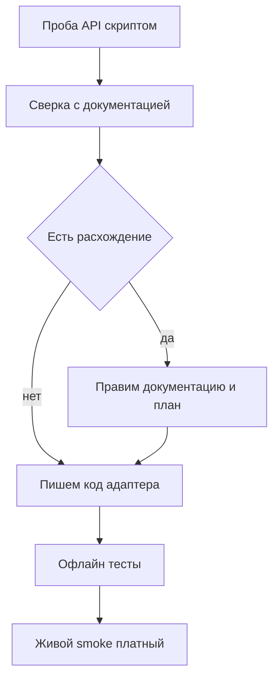

# Ретроспектива 2026-11-22 — подготовка decide-mcp и Шаг 0

## Задание

Распаковать документацию будущего проекта, разложить её по местам (AGENTS в корне, остальное в docs), перенять из Project-Foundation-Kit правила логирования и тестирования, сделать init-коммит. Далее: поднять каркас, подключить ключ Polza, пройти Шаг 0. Плюс правило — проверять внешнее API скриптами до кода.

## Что сделано

1. Распаковал архив, разложил главы по `docs/{architecture,foundation,instructions,plans,guides}`, README и AGENTS — в корень. Перенял из Kit четыре документа: политика и инструкция по логам, стратегия и инструкция по тестам.
2. Поднял каркас: `package.json`, `tsconfig.json`, `src/core/{types,config,registry}.ts`, `src/cli/smoke.ts`, тесты. Ключ Polza взял из `~/.pi/agent/auth.json` в `.env`, в чат не выводил.
3. Прописал правило: платные запросы разрешены, каждый прогон помечается `[PAID]`, стоимость фиксируется.
4. Прогнал Шаг 0 на Polza AI: каталог и четыре модели.

## Проверки (факты)

- `npm run build` — 0.
- `npm test` — 13/13.
- Smoke: 4/4 модели ответили 200. Итог прогона 0.01617212 ₽, с пробами 0.03234424 ₽.
- Окна контекста совпали: gemini 262K, ms 32K, jev 64K, luna 1.05M.
- Схема отчёта проверена `mmdc` — прошла.

## Главное: API не такое, как в документации

Проба скриптом до кода уберегла от работы под неверное API. Найдено:

1. Провайдер ждёт `criteria`, а не `options`/`levels`. Запрос с `options` — `HTTP 400`.
2. `output_tokens` не всегда 0 (ms 3, jev 69).
3. `confidence` есть шире, чем было описано.
4. Поиск каталога по имени пропускает `typesafe/jev` — нужен полный обход страниц.
5. HTTP 400 бывает ошибкой схемы (`BAD_REQUEST`), её нельзя делить как safety-блок.

Всё исправлено в документации и плане.

## Ошибки и что улучшить

- Первый smoke пропустил `jev` из-за поиска по имени. Пришлось повторить платный прогон. Вывод: сначала полностью проверь выборку данных (каталог), потом платные вызовы.
- Две пробные записи в `fixtures/` убрал в корзину — в рабочей папке мусора не оставил.

## Что дальше

Адаптер `providers/systemone.ts` (маппинг `bool → noul`, `options/levels → criteria`), затем `schema.ts`, батчер, store, engine и MCP. До батчера — проверить OpenRouter и поведение safety/overflow.

## Как работаем дальше

